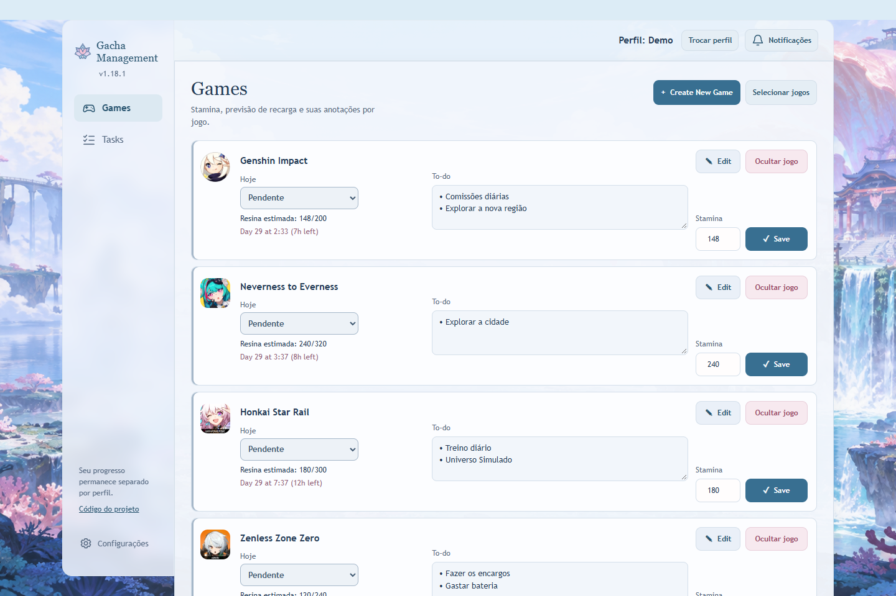

# Gacha Management Cloud

Organize a rotina dos seus jogos: acompanhe stamina, tarefas recorrentes, eventos e banners em um só lugar. A aplicação calcula quando os recursos estarão cheios e ajuda a decidir o que ainda falta fazer em cada jogo.

## Experimente com dados fictícios

**Ainda não há uma demo pública isolada.** A aplicação online usa perfis públicos e um banco compartilhado; ela não é uma área descartável para visitantes. [Execute a prévia local](#executar-a-prévia-local) para conhecer a interface sem acessar esse banco.



Captura da prévia descartável, com o tema Sangonomiya. Os dados dessa prévia somem ao encerrar o servidor.

## O que você pode fazer

- Estimar a stamina atual e quando cada jogo atingirá o limite, com taxas próprias de regeneração.
- Marcar a rotina como pendente, voltar depois ou feita por hoje, respeitando o reset diário.
- Organizar tarefas, favoritas e recorrências; filtrar e paginar a lista sem perder o contexto.
- Acompanhar eventos importados, revisar prazos e preservar ajustes manuais durante sincronizações.
- Consultar o calendário de banners e notificações por fase, com fontes e horários registrados.
- Separar progresso e preferências por perfil e acessar os dados salvos em navegador ou celular.

Perfis são públicos, sem autenticação: a seleção organiza dados, mas não oferece contas privadas. [Comportamento e prévia](docs/profiles-phases.md).

## Stack e decisões

| Parte        | Escolha e motivo                                                                                        |
| ------------ | ------------------------------------------------------------------------------------------------------- |
| Interface    | HTML, CSS e JavaScript com módulos ES; evolução incremental da aplicação existente.                     |
| Persistência | PostgreSQL/Supabase, migrações e operações transacionais para regras compartilhadas.                    |
| Integrações  | Descoberta de eventos por API; calendário de banners em JSON versionado, separado do progresso pessoal. |
| Verificação  | Jest, testes Node, DOM real e PostgreSQL descartável com PGlite; CI no GitHub Actions.                  |

Fusos, identidade por edição e preservação de decisões manuais são partes centrais do domínio. A leitura atualiza informações sem sobrescrever o que está sendo editado. [Convenções](docs/project-conventions.md) e [mapa dos guias](docs/README.md).

## Executar a prévia local

Requer Git, Node.js 20+ e npm. A prévia usa banco descartável e não acessa o Supabase:

```sh
git clone https://github.com/cristianworth/GachaManagement-cloud.git
cd GachaManagement-cloud
npm ci
node scripts/previewProfiles.js --design --port=5502
```

Abra **http://127.0.0.1:5502**. A prévia reutiliza o frontend e SQL reais, com dados fictícios. Ela não valida o serviço remoto nem a disponibilidade dos calendários externos. [Configuração de uma instância e integrações](docs/setup-and-integrations.md).

## Estado e limites

Versão **1.18.1**. Aplicação pessoal em evolução, com perfis públicos e integração de eventos dos cinco jogos ativos. A demonstração isolada para visitantes ainda precisa ser preparada.

O produto é guiado por Cristian, com desenvolvimento assistido por IA. As decisões de calendário, região e comportamento são registradas nos guias e no histórico de entregas. [Changelog](CHANGELOG.md) e [próximas prioridades](docs/roadmap-priorities.md).

## Verificar e acompanhar

```sh
npm test
```

Os testes usam dados congelados e banco descartável, sem consultar o banco pessoal. As [convenções de validação](docs/project-conventions.md) distinguem testes focados de fechamentos completos.

- [Mapa da documentação](docs/README.md).
- [Estado diário](docs/game-daily-state.md), [atualização silenciosa](docs/silent-refresh.md) e [paginação](docs/task-pagination-stamina.md).
- [Banners publicados](docs/banner-catalogue.md) e [integrações de eventos](docs/event-integrations.md).
- [Issues](https://github.com/cristianworth/GachaManagement-cloud/issues) para problemas e propostas com exemplos reproduzíveis.

O manifesto declara ISC, mas o texto de licença ainda precisa ser incluído na raiz. Dependências e recursos de terceiros mantêm suas próprias licenças e créditos; essa pendência não altera os avisos existentes.
